# NEXT-GEN E-COMMERCE DEVELOPMENT

*Real-Time API Sync for Automated Inventory & Product Data Integration*

*Built with the tools and technologies:*

## Overview

This project was completed during a full-stack developer internship at **JOLOF SYSTEM**. It delivers an e-commerce application for discovering and ordering products, together with a supplier-data integration that imports catalog and inventory information from the **Logicom QuickConnect API** into **Sanity**.

The work addresses a practical commerce problem: maintaining product descriptions, prices, and stock manually across separate systems is slow and can result in stale information, stockouts, or overselling. The project brings the storefront, content management, and supplier import process into one connected solution.

The repository contains two cooperating applications:

- **`frontend/`** — the customer-facing Next.js storefront and its application routes.
- **`backend/`** — the Sanity Studio, content schemas, and Logicom import code.

The system uses a headless architecture: the storefront reads product and content data from Sanity, while the import service transfers supplier data into the same content store.

## Project Goals

- Provide a responsive online catalog for JOLOF SYSTEM products.
- Give customers a way to search and browse products, manage a cart, and submit orders.
- Let administrators maintain catalog and order content through Sanity Studio.
- Reduce manual catalog and stock maintenance by importing supplier data from Logicom.
- Keep the supplier-to-catalog transformation explicit and traceable.

## Features

### Customer storefront

- Home page with promotional content, brands, categories, and selected products.
- Product listing with category navigation, search, and sorting.
- Product detail pages with pricing, stock state, images, and specifications.
- Shopping cart with quantity controls and an order summary.
- Sign-in and checkout flow integrated with Clerk.
- Order confirmation, order history, and order detail views.

### Catalog and order operations

- Sanity content types for products, categories, brands, banners, and orders.
- Sanity Studio screens for content editing and order administration.
- Order creation in Sanity, with order status available for operational follow-up.
- Order confirmation email and PDF summary generation in the create-order route.

### Supplier synchronization

- Authenticated requests to Logicom QuickConnect.
- Import of supplier brands, categories, and products.
- Mapping of supplier product fields—such as SKU, description, price, variants, specifications, and stock—to Sanity documents.
- Create/update behavior keyed by product SKU, with import counts for created, updated, and skipped records.

## Architecture and Data Flow

The application separates presentation, content management, and supplier integration:

1. **Logicom QuickConnect** is the upstream source for supplier catalog and inventory data.
2. **The import service** authenticates, fetches supplier data, maps it to the project’s content model, and writes it through the Sanity client.
3. **Sanity Content Lake** stores products, categories, brands, banners, and orders.
4. **The Next.js storefront** queries Sanity and renders customer-facing pages.
5. **Customer actions** such as checkout create orders in Sanity; order processing can generate a PDF and send a confirmation email.

The report illustrates the project’s core supplier-import pipeline below.

  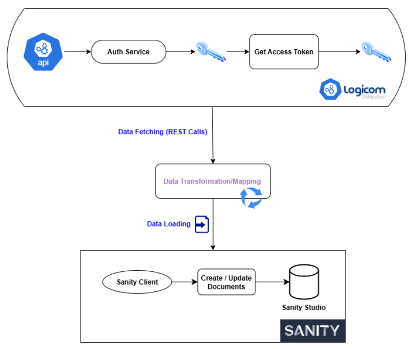
   
  ETL process: extract supplier data, transform it to the Sanity model, then load or update documents. Figure extracted from the internship report.

### Synchronization process

The import code runs brand, category, and product imports in sequence. For products, it retrieves existing Sanity documents, indexes them by SKU, requests supplier data, maps the response into the product schema, and creates or updates documents. The report presents scheduled pull as the intended operating strategy; the repository’s current npm scripts do not configure a scheduler.

  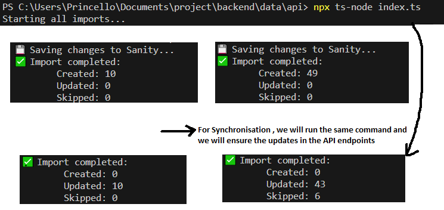
   
  Example import output reproduced from the report; these counts describe that run and are not a live service metric.

### Order flow

The report describes an MVC-inspired request flow for order creation: the storefront initiates the request, a Next.js route handles it, and the Sanity client persists the order. The route also contains the PDF and email confirmation steps.

  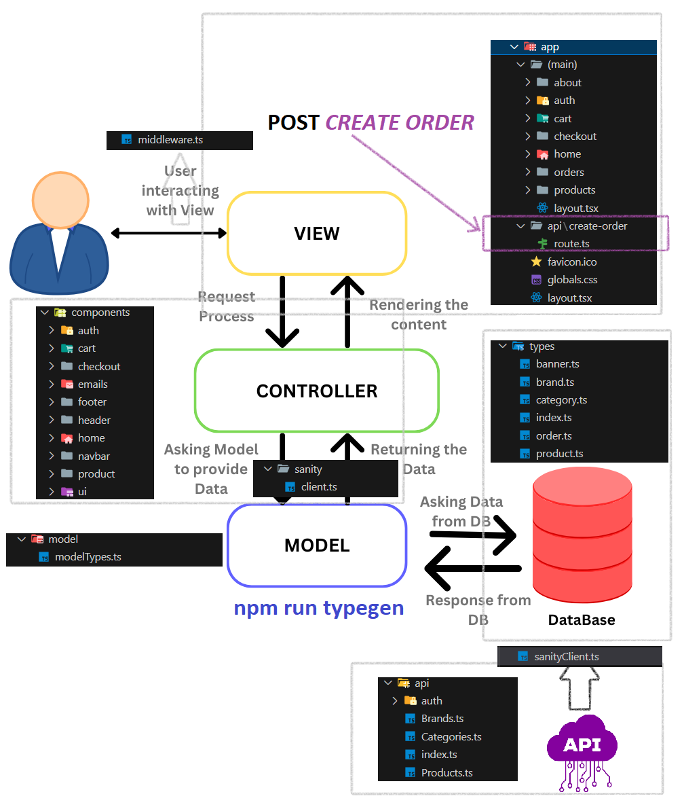
   
  Order creation flow documented in the internship report.

## Internship Methodology

The report follows a staged, evidence-driven development process. It does not identify a named framework such as Scrum; the steps below summarize the approach documented during the internship.

1. **Understand the business context.** Review JOLOF SYSTEM’s sales and catalog needs, identify problems with manual product and inventory updates, and define the customer, administrator, and logistics-manager roles.
2. **Translate needs into requirements.** Record customer journeys and administration tasks, then distinguish functional requirements (catalog, cart, orders, synchronization) from quality goals such as responsiveness, reliability, and scalability.
3. **Research and select the architecture.** Compare monolithic and headless approaches and select Next.js with Sanity so the presentation layer and content store can evolve independently.
4. **Validate the supplier contract before building the importer.** Use Postman to exercise Logicom endpoints, inspect authentication requirements and response payloads, and confirm the fields and data shapes required by the application.
5. **Design the data and integration flow.** Define the Sanity document model, establish the mapping from supplier fields to application fields, and plan the extract-transform-load sequence.
6. **Implement in connected modules.** Build the Logicom API client and import modules, then connect Sanity-backed product data to the storefront, cart, checkout, and order workflows.
7. **Check behavior with observable evidence.** Review API responses in Postman, inspect import success and record counts in the command output, and verify the customer and admin flows through the application screens captured in the report.
8. **Document outcomes and next steps.** Summarize the architecture, implementation, challenges, and possible extensions in the final-year internship report.

The use-case diagram below captures the main customer and administrator responsibilities that informed the requirements.

  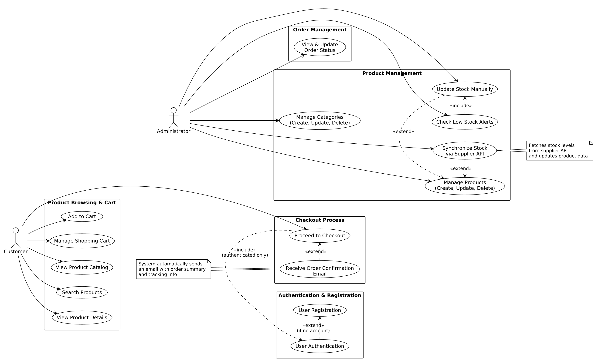
   
  Use-case diagram from the internship report.

## Data Model

Sanity is the primary content store for the project. The report identifies the following core document types:

| Document | Purpose |
|---|---|
| **Product** | Supplier-linked item details, including SKU, name, price, inventory, variants, specifications, and images. |
| **Category** | Product grouping, including hierarchical parent/child categories. |
| **Brand** | Manufacturer or brand information associated with products. |
| **Order** | Customer and delivery details, ordered items, totals, and order status. |
| **Banner** | Promotional content displayed by the storefront. |

The model diagram below is extracted from the report and shows the relationships between the principal documents and nested product/order data.

  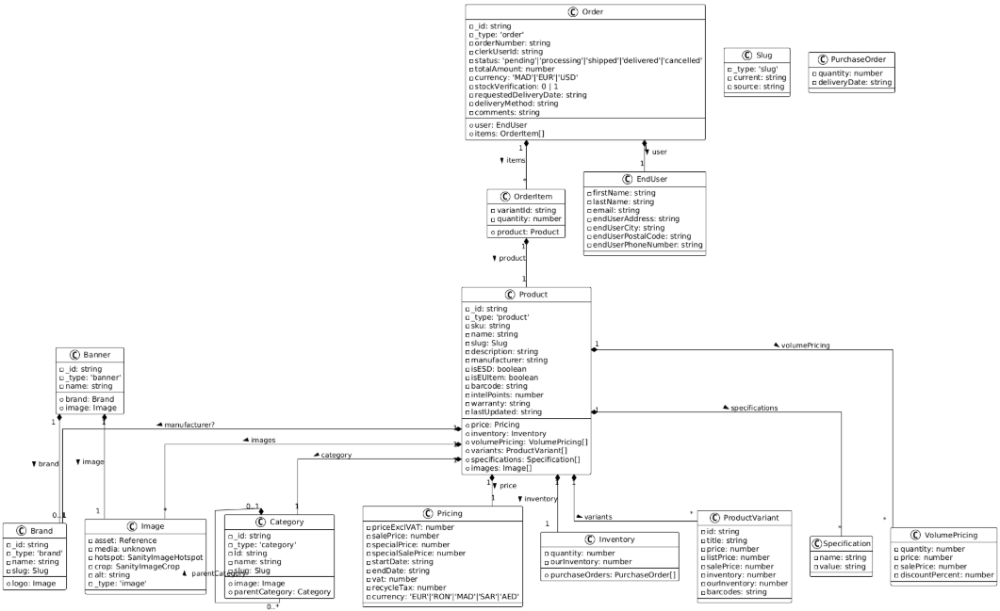
   
  Core Sanity schema model from the internship report.

## Application Screenshots

The following screenshots are selected from the implementation chapter of the internship report.

### Home page

  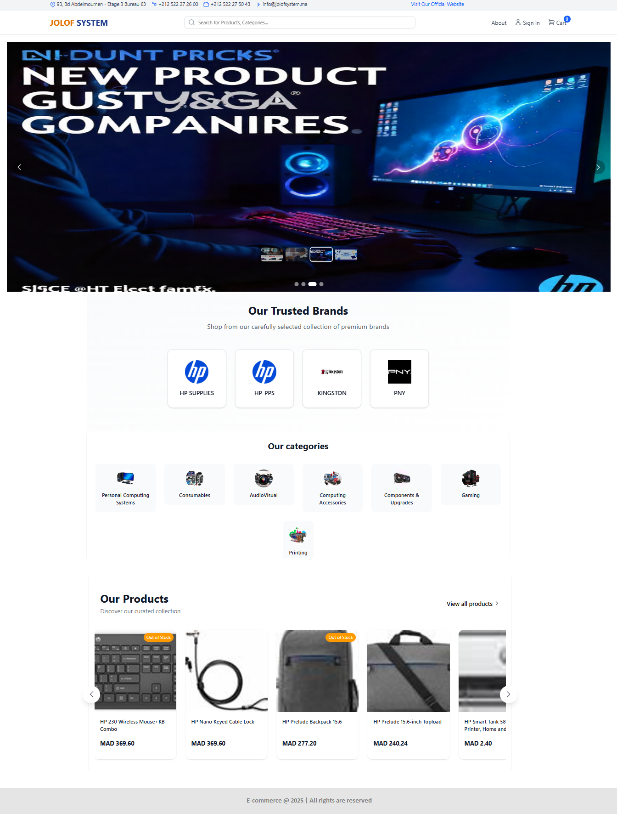
   
  Home page with the promotional carousel, brands, categories, and product cards.

### Product catalog

  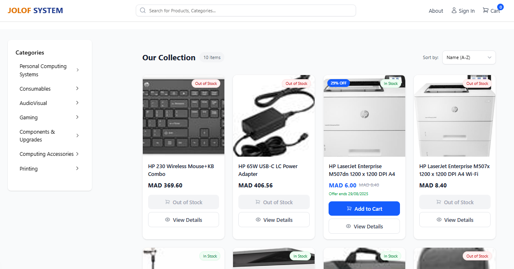
   
  Product listing with category navigation, stock indicators, and sorting.

### Product details

  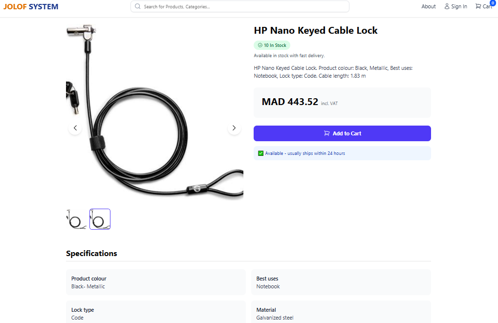
   
  Product detail page with availability, pricing, images, and specifications.

### Shopping cart

  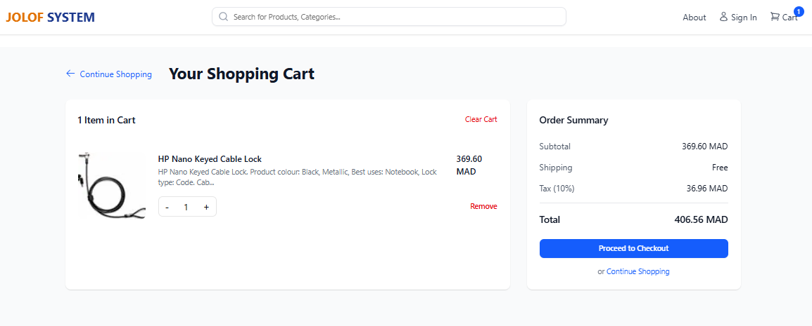
   
  Shopping cart with item controls and an order summary before checkout.

### Checkout

  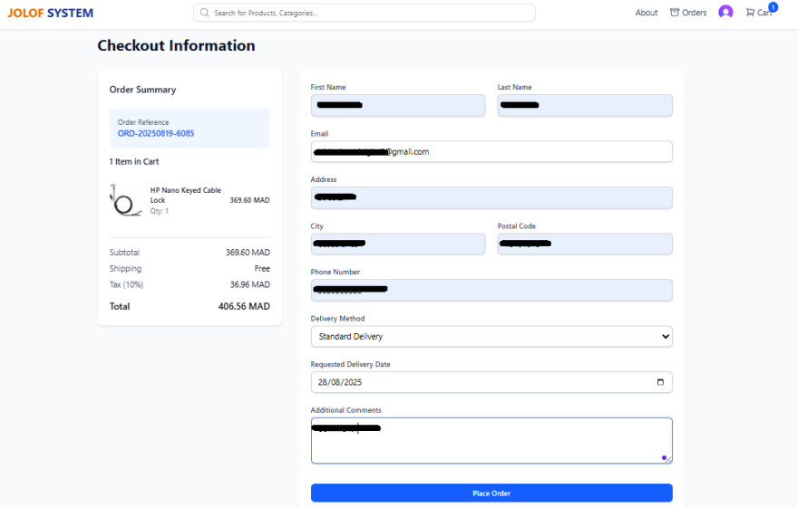
   
  Checkout form for entering delivery information and reviewing the order before submission.

### Order details and invoice

  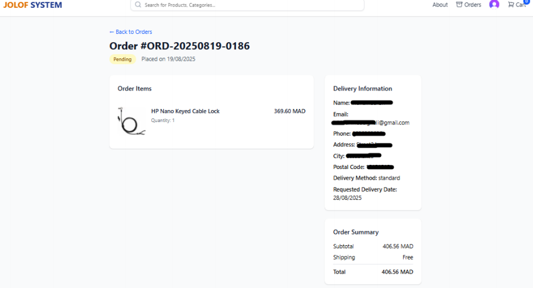
   
  Order details page showing the order status, items, delivery information, and totals.

  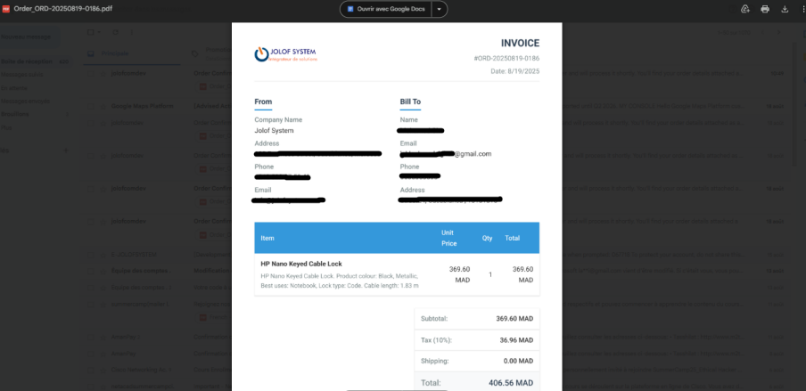
   
  PDF invoice generated for the order and included with the confirmation email.

### Sanity administration

  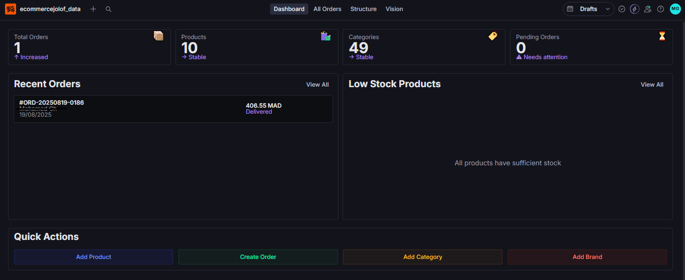
   
  Sanity Studio dashboard for catalog and order administration.

## Technology Stack

### Frontend

- **Next.js 15** and **React 19** — application framework and UI.
- **TypeScript** — typed application and content models.
- **Tailwind CSS** — responsive styling.
- **Redux Toolkit** — shared client state, including the shopping cart.
- **Clerk** — customer authentication.
- **Sanity client / GROQ** — content queries and writes.

### Backend and content

- **Sanity Studio 4** — content management interface and schema.
- **Sanity Content Lake** — product, category, brand, banner, and order documents.
- **Node.js and TypeScript** — supplier API client and import modules.
- **Axios and Node crypto** — HTTP requests and Logicom request authentication.
- **Nodemailer and Puppeteer** — order confirmation email and PDF generation.

### Development and delivery tools

- **Postman** — supplier API exploration and request/response validation.
- **Git and GitHub** — version control and project hosting.
- **Vercel** — identified in the report as a deployment option for the Next.js application.

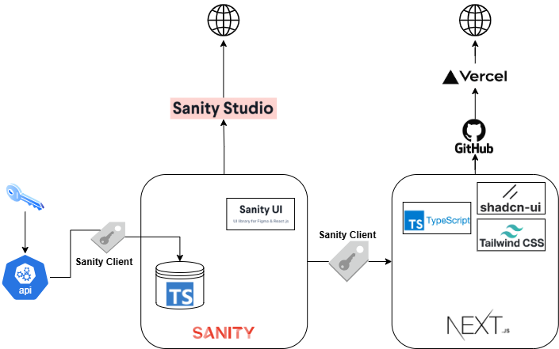

## Validation, Scope, and Future Work

The report documents manual API validation with Postman, import output showing created/updated/skipped records, and screenshots of the storefront and administration experience. The package manifests do not provide a project-wide automated test script.

The implementation should be treated as an internship project, not as a production deployment guarantee. In particular:

- The supplier synchronization entry point is present, but a recurring scheduler is not configured by the current npm scripts.
- External services (Sanity, Logicom, Clerk, and email) require valid project credentials and configuration to exercise their related flows.
- The report proposes further work such as supporting additional suppliers, improving caching, adding richer synchronization controls, and extending search and discovery features.
